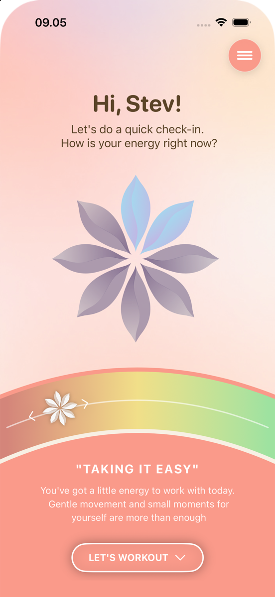
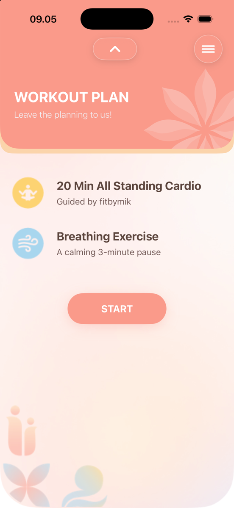
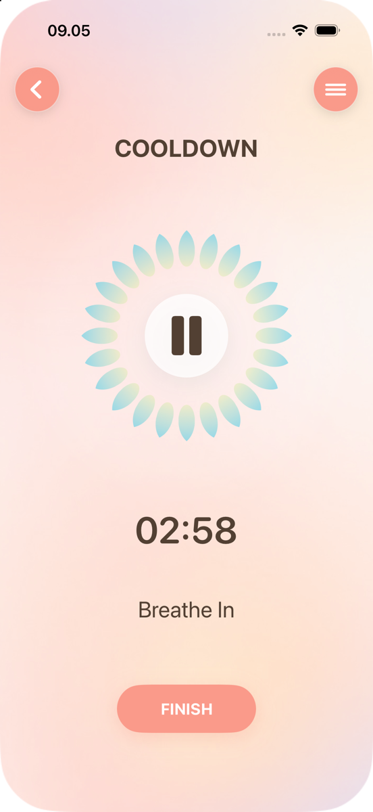
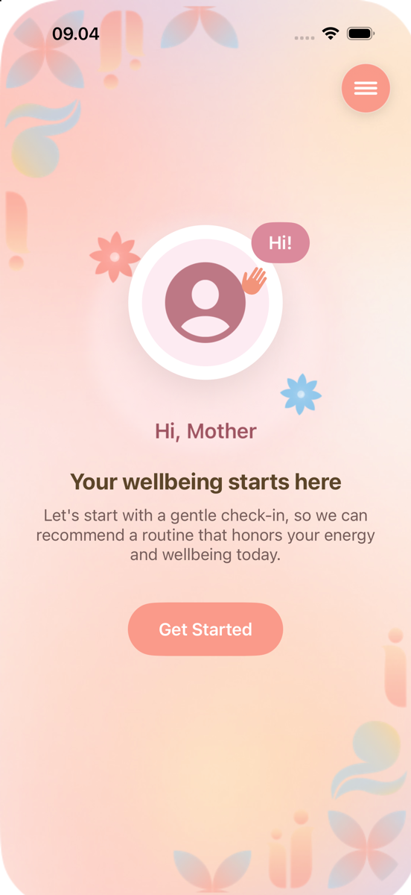
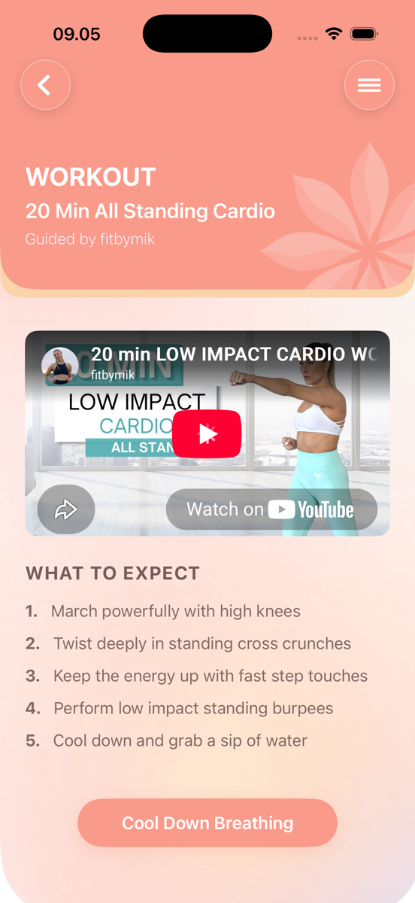
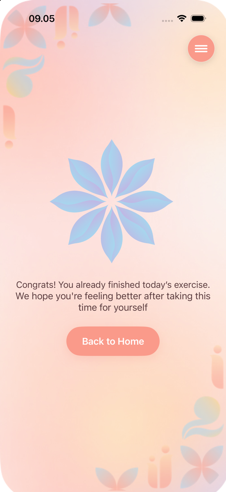

# MoM

A gentle workout app for mothers with toddlers. Built by a team of six for **Challenge 3 (From Pieces to Product)** at Apple Developer Academy @ BINUS – Bali, and shipped to TestFlight.

Busy mothers rarely have the time or a gym nearby to stay active. MoM starts with a quick energy check-in and recommends a guided workout that fits how they feel that day, followed by a calming breathing cooldown.

<p align="center">
  
  &nbsp;
  
  &nbsp;
  
</p>

## How It Works

1. **Onboarding:** a warm welcome, then the app asks what to call you
2. **Energy check-in:** slide along five energy levels, from Needing Rest to Energized, each with an encouraging message
3. **Workout plan:** a guided workout matched to your energy level, picked from a curated set of YouTube videos, plus a breathing cooldown
4. **Workout:** watch the video in the app, with a short list of what to expect
5. **Breathing cooldown:** a 3-minute guided breathing exercise with an animated flower and calming audio cues
6. **Finish:** a gentle note to celebrate finishing today's exercise

## Accessibility

- **Larger Text:** adjust text size from 100% to 130% in the menu
- **Dark Mode:** switch themes from the menu

## Screens

<table>
  <tr>
    <td align="center"><br>Onboarding</td>
    <td align="center"><br>Energy Check-in</td>
    <td align="center"><br>Workout Plan</td>
  </tr>
  <tr>
    <td align="center"><br>Workout</td>
    <td align="center"><br>Breathing Cooldown</td>
    <td align="center"><br>Finish</td>
  </tr>
</table>

## Tech Stack

- Swift, SwiftUI
- [YouTubePlayerKit](https://github.com/SvenTiigi/YouTubePlayerKit) (Swift Package) for in-app workout videos
- AVFoundation for breathing audio with cross-fade transitions
- `@AppStorage` for user preferences

## Getting Started

Requirements: Xcode 26 or later, iOS 26.5 or later.

1. Clone the repo
   ```bash
   git clone https://github.com/StevanusFelixiano/PiecestoProduct.git
   ```
2. Open `PiecestoProduct.xcodeproj` in Xcode (the Swift package resolves automatically)
3. Select an iPhone simulator and press **Run** (⌘R)

## Team

A team of six: four coders and two designers.

Stevanus · Julius · Satria · Ishandeep · Clarissa · Agatha
